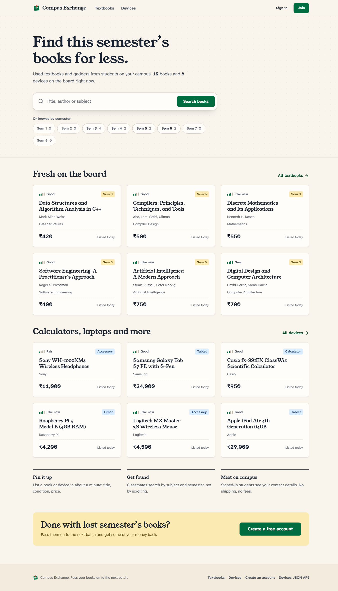
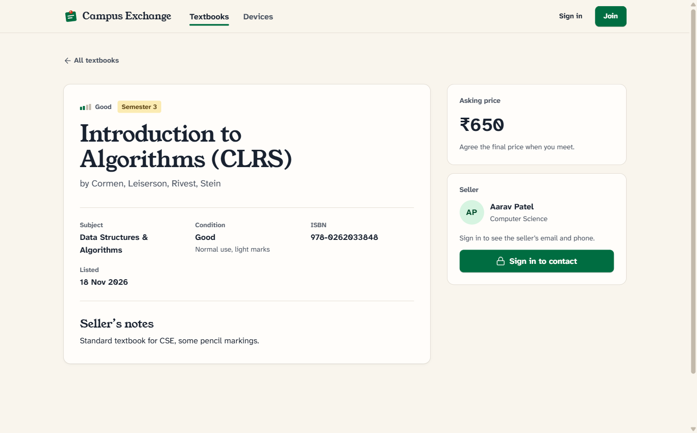
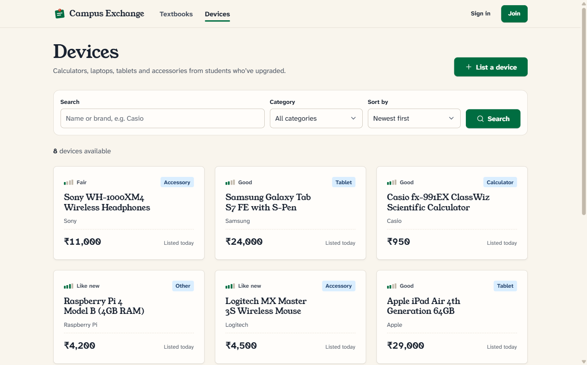
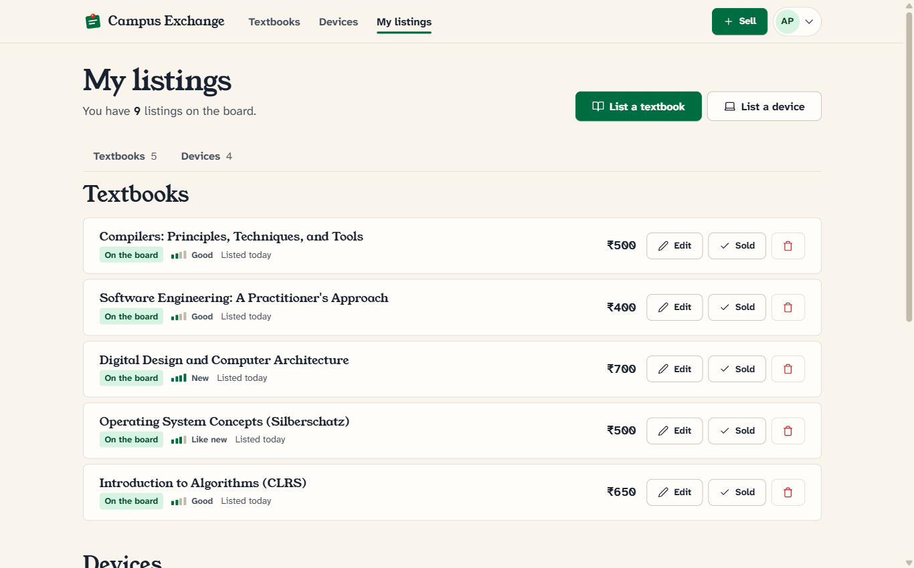
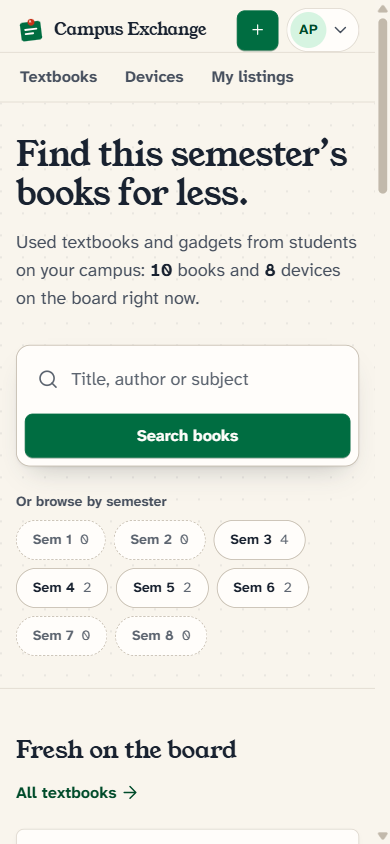

# Campus Exchange

> **Java & Spring Framework Lab (CS3603-1) — Mini Project**  
> V Semester CSE, Academic Year 2026-27  
> **Team 24CSC2, Section C**

A full-stack peer-to-peer campus marketplace where college students list and browse used **textbooks** and **electronic devices**.

## Screenshots

| Home | Textbook detail |
|---|---|
|  |  |

| Device catalogue (consumes the REST API) | Seller dashboard |
|---|---|
|  |  |

<p align="center"></p>

---

## Quick Start

**Requirements:** Java 17+ and Git. No database or Maven install is needed; the Maven Wrapper is included.

```bash
git clone https://github.com/zahy294/campus-exchange.git
cd campus-exchange

# Windows (PowerShell)
.\mvnw.cmd spring-boot:run

# Linux / macOS
./mvnw spring-boot:run
```

Open **http://localhost:8080** and sign in with a demo account:

| Email | Password |
|---|---|
| `student1@campus.edu` | `password123` |
| `student2@campus.edu` | `password123` |

The app starts on a file-based H2 database (created in `./data/` and seeded with sample books and devices on first run). To stop it, press `Ctrl+C`. To reset the data, stop the app and delete the `data/` folder.

---

## 1. Architecture & Tech Stack

Campus Exchange integrates two architectural patterns in a single Spring Boot application:

1. **Textbook Exchange (Server-Side MVC)**:
   - **Framework**: Spring MVC + Thymeleaf with responsive styling.
   - **Flow**: Controllers return view names; implements the **Post-Redirect-Get (PRG)** pattern with flash attributes and Thymeleaf fragments.
   - **Authentication**: HTTP Session via Spring Security Form Login with CSRF protection.

2. **Device Exchange (RESTful Web Service)**:
   - **Framework**: `@RestController` under `/api/devices`.
   - **Data Format**: Standard JSON request/response with complete DTO separation (`DeviceRequest` / `DeviceResponse`) to prevent entity leakage.
   - **Authentication**: HTTP Basic (for API clients and Postman) and Session authentication.
   - **Error Handling**: Centralized `@RestControllerAdvice` (`ApiExceptionHandler`) returning structured JSON error payloads.

3. **Client-Side Device Catalog (`/devices`)**:
   - A lightweight interactive page consuming `/api/devices` using browser `fetch()` to demonstrate client-side REST consumption.

### Technical Stack
* **Language & Runtime**: Java 17 (OpenJDK)
* **Framework**: Spring Boot 3.3.5 (`jakarta.*` namespace)
* **Security**: Spring Security 6 (BCrypt password encoder, session fixation protection)
* **Persistence**: Spring Data JPA + Hibernate
* **Database**: MySQL 8 for development/production; H2 in-memory database for automated tests
* **Validation**: Jakarta Bean Validation (`@NotBlank`, `@DecimalMin`, `@Email`, etc.)
* **Build System**: Maven Wrapper (`mvnw` / `mvnw.cmd`) included in repository

---

## 2. Key Engineering & Architecture Decisions

* **MySQL Reserved Word Resolution**:
  MySQL reserves the word `condition`. Both `Book` and `Device` entities explicitly map their condition property to `@Column(name = "item_condition", nullable = false)`. The shared enum is named `ItemCondition` (`NEW`, `LIKE_NEW`, `GOOD`, `FAIR`).
* **Preventing `LazyInitializationException` with `open-in-view=false`**:
  With `spring.jpa.open-in-view=false`:
  1. *REST Module*: Entity-to-DTO conversions are strictly encapsulated within `@Transactional(readOnly = true)` methods in `DeviceService`.
  2. *MVC Module*: Queries that render seller contact info utilize explicit `JOIN FETCH b.seller` JPQL in `BookRepository` to eagerly load seller proxies within the database transaction.
* **Dual `SecurityFilterChain` Architecture**:
  - **API Chain (`@Order(1)`)**: Configured with `securityMatcher("/api/**")`. CSRF is disabled for API clients, HTTP Basic is enabled, and a custom `AuthenticationEntryPoint` returns HTTP 401 JSON. `GET /api/devices/mine` is matched before the public wildcard `GET /api/devices/**`.
  - **Web Chain (`@Order(2)`)**: Configured for `/**`. CSRF is enabled by default for all HTML forms, permits named public routes, and delegates all other routes to `.anyRequest().authenticated()`.
* **Service-Layer Ownership Authorization**:
  Ownership checks are enforced in `BookService` and `DeviceService`. Attempting to modify or delete a listing owned by another student throws `ForbiddenOperationException`, producing HTTP 403.

---

## 3. Project Structure

```
src/main/java/com/campusexchange/
├── CampusExchangeApplication.java
├── config/          SecurityConfig (two filter chains), DataInitializer (seed data)
├── model/           Listing (shared @MappedSuperclass), Book, Device, User,
│                    ItemCondition, ListingStatus, DeviceCategory
├── repository/      UserRepository, BookRepository, DeviceRepository
├── dto/             RegisterForm, ProfileForm, PasswordChangeForm, BookForm,
│                    DeviceRequest, DeviceResponse, DeviceStatusRequest, ValidationRules
├── service/         UserService, BookService, DeviceService, ListingLifecycle,
│                    MyListingsSummary, ListingSort, Paging
├── security/        CustomUserDetailsService
├── controller/web/  HomeController, AuthController, BookController, DeviceController,
│                    ListingActionsController, AccountController   (Thymeleaf pages)
├── controller/api/  DeviceApiController                   (JSON REST API)
├── exception/       ApiExceptionHandler (JSON, api package only),
│                    WebExceptionHandler (HTML error pages, web package only),
│                    ResourceNotFound/ForbiddenOperation/DuplicateEmail exceptions
├── web/             Formats (@fmt: ₹ Indian grouping, dates), GlobalModelAttributes
└── util/            Text (trimming, email normalisation)

src/main/resources/
├── templates/       index, login, register, books/*, devices/*, account/profile,
│                    error/{403,404,500,error}, fragments/{layout,cards,icons}
└── static/          css/style.css, js/app.js, fonts/ (self-hosted, OFL), favicon.svg
```

### Architecture notes
* **One home for each rule** :
  * `ListingLifecycle`: the only place that checks ownership and sells, relists or withdraws a listing, for books and devices alike. Web actions (`ListingActionsController`, `/{books|devices}/{id}/sold|available|delete`) and the API both go through it.
  * `SellerCard`: the only place that decides what a viewer sees of a seller. Anonymous viewers get no email or phone. The API and both detail pages render from it.
  * `ItemCondition`, `DeviceCategory`, `ListingSort`: the only vocabulary for labels, wear grades, categories and sort keys. The API sends labels, so the browser catalogue keeps no copies. Category validation checks the enum (`@DeviceCategoryName`).
  * `MyListingsSummary`: dashboard totals, a pure class with unit tests.
  * Form-to-entity mapping lives on the DTOs (`BookForm`, `DeviceRequest`). `Paging` clamps bad page and size input.
* **Two error worlds.** `ApiExceptionHandler` only advises `controller.api` and always answers JSON (400/403/404/405/415/500). `WebExceptionHandler` only advises `controller.web` and renders the HTML error templates with the right status.
* **No frontend framework.** Pages are server-rendered Thymeleaf with plain CSS. Small vanilla JS adds progressive enhancements (menus, confirm dialogs, double-submit guard, character counters). Every page works without JavaScript except the client-rendered device catalogue, which demonstrates consuming the REST API.

## 4. Setup and Running

### Prerequisites
* **Java 17+** (OpenJDK / Adoptium)
* **MySQL 8** only if you use the `mysql` profile

### Database Configuration
By default the app uses a file-based **H2** database in MySQL compatibility mode (`./data/`), so it runs with zero setup. The H2 console is at `/h2-console` in this default profile only.

To use MySQL 8, activate the `mysql` profile (`application-mysql.properties`) and supply credentials through environment variables:
```powershell
# Windows PowerShell
$env:DB_USER="root"
$env:DB_PASSWORD="your_mysql_password"
$env:REMEMBER_ME_KEY="any-long-random-string"   # signs remember-me cookies
.\mvnw.cmd spring-boot:run "-Dspring-boot.run.profiles=mysql"
```

If the database `campus_exchange` does not exist, the driver creates it (`createDatabaseIfNotExist=true`).

### Running the Application
Using the bundled Maven wrapper:

```powershell
# Windows
.\mvnw.cmd spring-boot:run

# Linux / macOS
./mvnw spring-boot:run
```

Once started, open your browser at **`http://localhost:8080`**.

### Running Automated Tests
All unit and integration tests run against an isolated in-memory **H2 database** without requiring a local MySQL instance:

```powershell
# Windows
.\mvnw.cmd test

# Linux / macOS
./mvnw test
```

---

## 5. Seed Data & Demo Accounts

When the application starts against an empty database, `DataInitializer` automatically populates:
* **2 Demo Student Accounts**:
  | Email | Password | Department |
  |---|---|---|
  | `student1@campus.edu` | `password123` | Computer Science |
  | `student2@campus.edu` | `password123` | Electronics & Comm |
* **10 Textbooks** across CSE and ECE courses (CLRS Algorithms, Silberschatz OS & DBMS, Tanenbaum Networks, etc.)
* **8 Electronic Devices** across laptops, graphing calculators, tablets, and accessories.

---

## 6. Endpoints Reference

### Web routes
| Method | Path | Access | Description |
|---|---|---|---|
| `GET` | `/` | Public | Search-first home: search, semester chips with counts, newest books and devices |
| `GET` | `/register`, `/login` | Public | Sign up / sign in (remember-me supported) |
| `POST` | `/logout` | Signed in | Sign out |
| `GET` | `/books` | Public | Browse textbooks: `q`, `semester`, `sort` (newest, oldest, price_asc, price_desc), `page` |
| `GET` | `/books/{id}` | Public | Book detail. Seller email/phone only for signed-in users |
| `GET`/`POST` | `/books/new`, `/books` | Signed in | List a textbook |
| `GET`/`POST` | `/books/{id}/edit`, `/books/{id}` | Owner | Edit a textbook |
| `POST` | `/books/{id}/sold`, `/books/{id}/available` | Owner | Mark sold / put back on sale |
| `POST` | `/books/{id}/delete` | Owner | Delete |
| `GET` | `/devices` | Public | Device catalogue rendered in the browser from `/api/devices` |
| `GET` | `/devices/{id}` | Public | Device detail |
| `GET`/`POST` | `/devices/new`, `/devices` | Signed in | List a device |
| `GET`/`POST` | `/devices/{id}/edit`, `/devices/{id}` | Owner | Edit a device |
| `POST` | `/devices/{id}/sold`, `/devices/{id}/available`, `/devices/{id}/delete` | Owner | Status and delete |
| `GET` | `/my/listings` | Signed in | Seller dashboard (all books and devices, quick actions) |
| `GET`/`POST` | `/account`, `/account/password` | Signed in | Edit profile, change password |

Unknown or deleted listings show a friendly 404 page; acting on someone else's listing shows a 403 page.

### REST API (Device Exchange)
Base path: `/api/devices`. Header: `Content-Type: application/json`.
| Method | Path | Auth | Success | Description |
|---|---|---|---|---|
| `GET` | `/api/devices` | Public | 200 | Filter by `category`, `q`; `sort`, `page`, `size` (max 50) |
| `GET` | `/api/devices/{id}` | Public | 200 | Device detail (404 if missing) |
| `GET` | `/api/devices/mine` | Basic/session | 200 | Your devices |
| `POST` | `/api/devices` | Basic/session | 201 | Create (`Location` header) |
| `PUT` | `/api/devices/{id}` | Owner | 200 | Full update |
| `PATCH` | `/api/devices/{id}/status` | Owner | 200 | `{"status":"SOLD"}` or `AVAILABLE` |
| `DELETE` | `/api/devices/{id}` | Owner | 204 | Delete |

Anonymous callers get `seller` without the `email` field. Errors are JSON `{timestamp,status,error,message,path,fieldErrors?}` with 400 (validation, malformed JSON, unknown enum), 401, 403, 404, 405 and 415.

### Validation rules (server-side, mirrored in the HTML forms)
| Field | Rule |
|---|---|
| Full name | Required, 2-100 chars, letters/spaces/`.'-` only |
| Email | Required, valid format, max 150, unique (case-insensitive) |
| Password | 8-64 chars with at least one letter and one number; confirmation must match |
| Phone | Optional, Indian mobile: 10 digits starting 6-9, optional `+91` |
| Book title / author | Required, max 200 / 150 |
| ISBN | Optional, ISBN-10 or ISBN-13 (hyphens/spaces allowed) |
| Semester | Optional, 1-8 |
| Device category | Required, one of LAPTOP, PHONE, TABLET, CALCULATOR, ACCESSORY, OTHER |
| Condition | Required, NEW, LIKE_NEW, GOOD or FAIR |
| Price | Required, ₹0 to ₹5,00,000, max 2 decimals |
| Description | Optional, max 1000 chars |

## 7. Testing with Postman

An exported Postman collection is included at:
**`postman/CampusExchange.postman_collection.json`**

### Collection Contents
1. **Public Endpoints**: Paged device lists, category filters, and 404 tests.
2. **Authenticated Operations**: Create, update, status patch, and delete using HTTP Basic auth (`student1@campus.edu` / `password123`).
3. **Security & Boundary Tests**:
   - `401 Unauthorized`: Calling `POST /api/devices` without credentials returns JSON error payload.
   - `400 Bad Request`: Submitting negative price or empty name returns validation errors.
   - `403 Forbidden`: Authenticating as `student2@campus.edu` and attempting to update/delete `student1`'s device returns HTTP 403.

---

## 8. Viva & Evaluation Guide

Questions your lab examiner or professor may ask during evaluation:

1. **Why use two `SecurityFilterChain` beans instead of one?**
   * *Answer*: Browser requests need form login with HTML redirects and CSRF protection, while REST clients/Postman need stateless HTTP Basic, disabled CSRF for mutations, and JSON 401 error payloads instead of HTML redirects. Configuring `@Order(1)` for `/api/**` and `@Order(2)` for `/**` cleanly separates these concerns.
2. **Why does `GET /api/devices/mine` need to be matched before `GET /api/devices/**`?**
   * *Answer*: Spring Security evaluates matchers in order. If the public wildcard `GET /api/devices/**` came first, `/api/devices/mine` would match the public rule and lose authentication enforcement.
3. **How is `LazyInitializationException` prevented with `open-in-view=false`?**
   * *Answer*: Since OSIV is disabled to conserve database connections, lazy associations cannot be fetched in the view layer. We prevent this by initializing seller data inside `@Transactional` service methods (for DTO mapping) and using explicit `JOIN FETCH b.seller` queries in `BookRepository` when loading views that display seller details.
4. **Why are DTOs used for the REST API instead of returning JPA entities directly?**
   * *Answer*: Returning entities directly risks exposing sensitive fields (like password hashes), triggering lazy loading serialization loops, or binding unexpected input fields (over-posting). DTOs enforce a strict contract.
